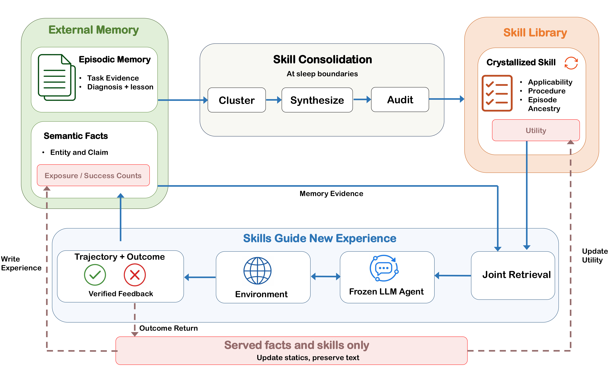

<div align="center">

  <h3>MemCryst: Bidirectional Coevolution of Memory and Skills for Lifelong LLM Agents</h3>

  <p>
    <a href="https://tianyi0216.github.io/">Tianyi Xu</a><sup>1</sup>
  </p>

  <p>
    <sup>1</sup> University of Wisconsin&ndash;Madison
  </p>

  <p>
    
    <a href="https://github.com/tianyi0216/Memcryst">
      
    </a>
    
    
  </p>

</div>

---

## Overview

<p align="center">
  
</p>

MemCryst lets a deployed LLM agent keep learning while the language model
stays frozen. Every completed interaction is written to an external memory (an
episodic entry plus typed semantic facts); recurring episode clusters are
compiled into audited, conditional skills at sleep boundaries; and the two
layers coevolve in both directions:

* **memory -> skills**: episodes and facts are the evidence from which skills
  are created and revised;
* **skills -> memory**: the skills served to the actor shape the episodes that
  are written next, and task outcomes are returned to the facts and skills that
  were served (outcome-governed selection: statistics are updated, text is
  preserved).

The agent runs in a wake/sleep loop over a task stream. Every task is scored
*before* the system learns from it (prequential scoring), so the per-task record
is the lifelong learning curve.

```
wake  : attempt N tasks with the current banks  ->  write episodes + facts, return outcomes
sleep : mine clusters -> synthesize skill drafts -> audit gate -> commit / revise skills
```

## Setup

```bash
conda create -n memcryst python=3.11 -y
conda activate memcryst
pip install -r requirements.txt
```

The pipeline talks to any OpenAI-compatible chat endpoint. The paper uses a
frozen Qwen3-8B served locally with vLLM:

```bash
pip install vllm
bash serve_vllm.sh                 # Qwen/Qwen3-8B on http://127.0.0.1:8000/v1 (8192-token window)
```

Thinking mode is disabled automatically for Qwen3 models. To use a hosted
model instead, set `model.name` / `model.base_url` in the config and export the
key named by `model.api_key_env` (default `OPENAI_API_KEY`).

## Quick start

```bash
# 1. Data: download the ALFWorld text games (~2 GB).
bash data/prepare_alfworld.sh
export ALFWORLD_DATA=$PWD/data/raw/alfworld

# 2. Smoke test: one cycle of three tasks against the local endpoint.
bash run_alfworld.sh configs/alfworld_smoke.yaml

# 3. Full lifelong run: 20 cycles x 30 tasks on ALFWorld.
bash run_alfworld.sh configs/alfworld_full.yaml

# 4. Summarize any finished run(s).
bash eval.sh runs/alfworld_full/lifelong.json
```

Each launcher takes an optional config path; `src/run.py` also accepts
`--set key.path=value` overrides and `--dry-run`:

```bash
python src/run.py --config configs/alfworld_full.yaml --set skills.top_k=1 --set run.name=alfworld_k1
```

## Repository layout

```
config.yaml                 default configuration (= configs/alfworld_full.yaml)
configs/                    one YAML per experiment (full / ablations / smoke / QA stream)
run_alfworld.sh             lifelong run on ALFWorld
run_dialsim.sh              lifelong run on the conversational QA stream
run_ablations.sh            vanilla / memory-only / skill-only / no-skill-revision, sequentially
run_order_robustness.sh     the full recipe under four shuffled task orders
eval.sh                     summarize finished runs
serve_vllm.sh               serve the frozen backbone with vLLM
data/                       data preparation (see data/README.md)
  prepare_alfworld.sh       download ALFWorld
  build_order_manifests.py  task-order manifests
  manifests/alf_order/      canonical first-600 list + four shuffled permutations
  processed/dialsim/        conversational QA event stream
src/run.py                  config -> environment switches + CLI, streams the log
src/metrics.py              success rate, per-family and per-cycle summaries
src/memcryst/               the pipeline
  pipeline/lifelong.py      wake/sleep loop (entry point)
  agent/                    ReAct actor, ALFWorld and task-stream environments, wake-time writeback
  memory_bank/              episodic entries, semantic facts, retrieval, outcome statistics
  skill_bank/               SKILL.md schema, persistence, capability index, retrieval
  sleep/                    pattern miner, skill synthesizer, audit gate, skill->memory feedback
  prompts/                  synthesis and audit prompts (markdown)
```

## Configuration

All runtime behaviour is driven by one YAML file. Top-level groups:

| Key | Purpose |
|-----|---------|
| `run.name`, `run.out_root` | run directory `runs/<name>/` (bank, `lifelong.json`, `run.log`, `resolved_config.json`) |
| `model.name`, `model.base_url`, `model.roles` | served model and endpoint; optional per-role models (actor / writeback / synthesis / audit) |
| `env.kind` | `alfworld` or `taskstream` (conversational QA); split, held-out probe, step budget, optional `order_manifest` |
| `stream.num_cycles`, `stream.tasks_per_cycle` | stream length and sleep period |
| `actor.mode` | `capability_plus_semantic` (skills + facts served) or `vanilla` (plain actor); navigation hint and working-memory guard |
| `memory.*` | facts served per task (`top_k`), verbatim excerpt layer, embedder |
| `skills.*` | skills served per task (`top_k`), revision on/off (`refine`), synthesis prompt, admission probe, `freeze_after` |
| `feedback.memory_return`, `feedback.skill_return` | return task outcomes to the served facts / skills |
| `extra_env` | any additional `MEMCRYST_*` switch |

The resolved environment and command line are written to
`runs/<name>/resolved_config.json` for every run.

## Experiments

| Config | What it runs |
|--------|--------------|
| `configs/alfworld_full.yaml` | full recipe: memory + skills served, both return channels on |
| `configs/alfworld_vanilla.yaml` | plain ReAct actor with the same guard and hint (nothing served) |
| `configs/alfworld_memory_only.yaml` | memory served, skill layer removed |
| `configs/alfworld_skill_only.yaml` | skills served, memory not served |
| `configs/alfworld_no_skill_revision.yaml` | skills created but never revised |
| `configs/alfworld_smoke.yaml` | one cycle of three tasks |
| `configs/dialsim_full.yaml` | full recipe on the conversational QA stream (200 sessions + 957 questions) |
| `configs/dialsim_vanilla.yaml` | plain actor on the same stream |

`run_ablations.sh` runs the four ALFWorld reference / ablation configs in
sequence; `run_order_robustness.sh` repeats the full recipe under four
shuffled task orders and reports mean, sample SD and min-max over runs. A
full ALFWorld run (600 tasks) takes about 3-4 hours on one L40-class GPU
serving Qwen3-8B; the QA stream takes a few hours.

## Outputs

`runs/<name>/lifelong.json` holds, per cycle, the wake records
(`per_task`: task index, family, success, steps, reward, game file) and the
sleep statistics (clusters mined, skills created / revised). `runs/<name>/bank/`
is the final state: `memory/` (episodic entries), `semantic/` (facts with
outcome statistics) and `skills/<slug>-<id>/SKILL.md` (audited skills with
provenance). `bash eval.sh` prints the success rate, per-family rates, the
per-cycle curve and the first-to-last-quarter change.

## Citation

```bibtex
@misc{xu2026memcryst,
      title={MemCryst: Bidirectional Coevolution of Memory and Skills for Lifelong LLM Agents},
      author={Tianyi Xu},
      year={2026},
      eprint={TBD},
      archivePrefix={arXiv},
      primaryClass={cs.CL},
      url={https://github.com/tianyi0216/Memcryst},
}
```

## License

MIT. See [LICENSE](LICENSE).
